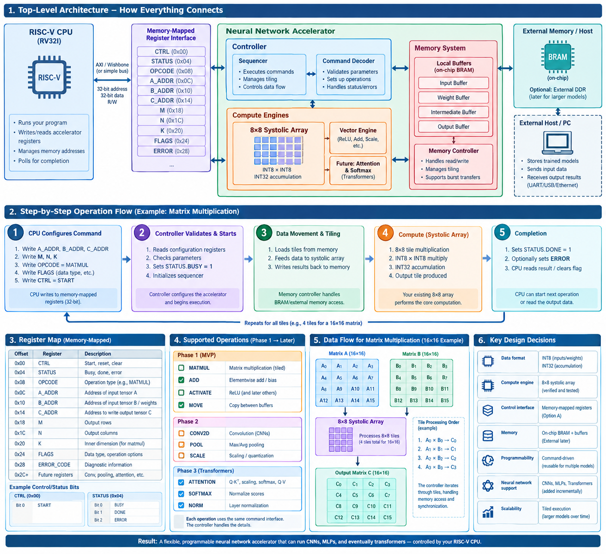

# RISC-V TPU Accelerator



An INT8 neural network accelerator implemented in SystemVerilog on a **Digilent Basys 3 FPGA**. The project combines a custom 8×8 systolic array, dense-layer controllers, banked on-chip memory, and UART communication to perform neural network inference on hardware.

The goal is to explore how specialized hardware accelerates neural network workloads compared with running the same model in software.

## Project Overview

The accelerator runs a quantized neural network using an 8-bit integer datapath.

The current network architecture consists of:

- **Input:** 784 values (28×28 image)
- **Hidden layer:** 128 neurons
- **Output layer:** 32 classes
- **Arithmetic:** INT8 weights and activations with wider accumulators
- **Compute engine:** Shared 8×8 systolic array
- **Processing elements:** 64

A Python application allows a user to draw an image, run local inference using TensorFlow Lite, and send the same image to the FPGA for hardware inference.

The FPGA returns its predicted class over UART.

## Hardware Architecture

The main hardware components are:

| Component | Purpose |
|---|---|
| `tpu_top.sv` | Top-level neural network accelerator |
| `systolic_array_8x8.sv` | 8×8 parallel multiply-accumulate array |
| `systolic_pe.sv` | Individual systolic processing element |
| `dense_layer_controller.sv` | Controls dense-layer computation and weight loading |
| `dense_tile_controller.sv` | Coordinates tiled matrix operations |
| `requantize_int8.sv` | Converts accumulated values back to INT8 |
| `uart_rx.sv` | Receives serial data |
| `uart_tx.sv` | Transmits serial data |
| `uart_tpu_controller.sv` | Coordinates image reception and inference |
| `uart_tpu_system.sv` | Integrates UART and TPU hardware |

### Tiled Computation

The accelerator uses an 8×8 systolic array to perform matrix multiplication.

Because the neural network dimensions exceed the array dimensions, computations are divided into smaller tiles.

The same systolic array is reused for the hidden and output layers, reducing the amount of hardware required.

### Weight Banking and Parallel Memory Access

To improve systolic array loading efficiency, the accelerator uses an **eight-bank weight memory architecture**.

Instead of storing all 64 weights for an 8-neuron tile in a single memory structure that must be accessed sequentially, the weights are distributed across eight independent memory banks.

Each bank supplies weights for one processing element column of the systolic array.

For a neuron index $n$ and input feature index $f$, the memory mapping is:

$$
\text{bank} = n \bmod 8
$$

$$
\text{bank}_{\text{addr}} = \left\lfloor \frac{n}{8} \right\rfloor F + f
$$

Where:

- $n$ is the output neuron index.
- $f$ is the input feature index.
- $F$ is the number of input features in the layer.
- Each bank stores weights for neurons assigned to that bank.

This organization allows all eight banks to be accessed simultaneously for a given input feature.

As a result, the controller can retrieve the weights needed for eight neurons in parallel rather than reading each neuron's weights individually.

#### Weight Loading Optimization

The `dense_layer_controller.sv` manages the banked memory access sequence.

The optimized loading process uses three stages:

1. `LOAD_W_ADDR`: Generates the addresses for the eight weight banks.
2. `LOAD_W_WAIT`: Allows the synchronous memory reads to complete.
3. `LOAD_W_SAVE`: Captures the returned weights into the appropriate registers.

For an eight-neuron tile, the weight-loading process requires eight feature-column reads, with three controller cycles per feature column.

| Loading operation | Original approach | Banked approach |
|---|---:|---:|
| Weight memory reads | 64 | 8 |
| Cycles per read | 3 | 3 |
| Total weight-loading cycles | 192 | 24 |
| Activation-loading cycles | 24 | 24 |
| Total tile-loading cycles | 216 | 48 |

This reduces the total tile-loading overhead from 216 cycles to 48 cycles, a **4.5× reduction in loading cycles**.

The optimization improves memory parallelism without increasing the number of processing elements. It also allows the same banked memory architecture to support both the hidden and output layers.

### Numeric Representation

The network uses INT8 quantized weights and activations. Accumulation uses wider arithmetic to preserve intermediate results before requantization.

Weights, biases, multipliers, and shift values are initialized using `.mem` files.

These memory initialization files are incorporated into the FPGA design during synthesis.

## Mathematical Foundations

This section describes the mathematical operations performed by the neural network and implemented by the FPGA accelerator.

### 1. Dense Layer Computation

A dense layer calculates the weighted sum of its input features for every output neuron.

The general matrix equation is:

$$
\mathbf{Y} = \mathbf{W}\mathbf{X} + \mathbf{b}
$$

For an individual output neuron:

$$
y_j = \sum_{i=0}^{N-1} W_{j,i}\, x_i + b_j
$$

Where:

- $N$ is the number of input features.
- $W_{j,i}$ is the weight connecting input $i$ to neuron $j$.
- $x_i$ is the input activation.
- $b_j$ is the neuron's bias.
- $y_j$ is the resulting accumulated value.

For the current network:

**Hidden layer:**

$$
\mathbf{H} = \mathbf{W}_{\text{hidden}}\mathbf{X} + \mathbf{b}_{\text{hidden}}
$$

$$
\mathbf{W}_{\text{hidden}} \in \mathbb{R}^{128 \times 784}, \qquad
\mathbf{X} \in \mathbb{R}^{784 \times 1}, \qquad
\mathbf{H} \in \mathbb{R}^{128 \times 1}
$$

**Output layer:**

$$
\mathbf{Y} = \mathbf{W}_{\text{output}}\mathbf{H} + \mathbf{b}_{\text{output}}
$$

$$
\mathbf{W}_{\text{output}} \in \mathbb{R}^{32 \times 128}, \qquad
\mathbf{H} \in \mathbb{R}^{128 \times 1}, \qquad
\mathbf{Y} \in \mathbb{R}^{32 \times 1}
$$

The network therefore performs:

$$
784 \rightarrow 128 \rightarrow 32
$$

### 2. Multiply-Accumulate Operation

The fundamental operation inside each systolic processing element is the multiply-accumulate (MAC).

$$
\text{ACC}_{\text{next}} = \text{ACC}_{\text{current}} + A \times B
$$

For a complete dot product:

$$
\text{ACC} = \sum_{i=0}^{N-1} A_i B_i
$$

Each processing element performs multiplication and accumulation as data moves through the systolic array.

The wider accumulator preserves intermediate precision while the input operands and weights use INT8 representation.

### 3. Systolic Array Matrix Multiplication

The accelerator uses an 8×8 array containing 64 processing elements.

The array processes up to eight rows and eight columns of a matrix multiplication tile in parallel.

For matrix multiplication:

$$
\mathbf{C} = \mathbf{A}\mathbf{B}, \qquad
\mathbf{A} \in \mathbb{R}^{M \times K}, \quad
\mathbf{B} \in \mathbb{R}^{K \times N}, \quad
\mathbf{C} \in \mathbb{R}^{M \times N}
$$

Each output element is:

$$
C_{i,j} = \sum_{k=0}^{K-1} A_{i,k}\, B_{k,j}
$$

Because the matrices can exceed the physical array dimensions, they are divided into smaller tiles.

For an 8×8 tile:

$$
\mathbf{C}_{\text{tile}} = \mathbf{A}_{\text{tile}}\mathbf{B}_{\text{tile}}
$$

The complete matrix is constructed by accumulating the results of the corresponding tiles.

The number of tiles along each matrix dimension is:

$$
T_M = \left\lceil \frac{M}{8} \right\rceil, \qquad
T_N = \left\lceil \frac{N}{8} \right\rceil, \qquad
T_K = \left\lceil \frac{K}{8} \right\rceil
$$

The total number of tile combinations is:

$$
T_{\text{total}} = T_M \cdot T_N \cdot T_K
$$

### 4. INT8 Quantization

The neural network uses integer representations instead of floating-point values to reduce hardware complexity and memory requirements.

An affine quantization relationship maps a real-valued number to an integer:

$$
q = \text{round}\!\left(\frac{r}{s}\right) + z
$$

The reverse relationship is:

$$
r = s\,(q - z)
$$

Where:

- $r$ is the original real-valued number.
- $q$ is the quantized integer.
- $s$ is the quantization scale.
- $z$ is the zero point.

The zero point allows real zero to be represented by an integer value that is not necessarily zero.

For signed INT8:

$$
-128 \le q \le 127
$$

The weights and activations are represented using INT8 values, while intermediate accumulation uses wider arithmetic.

### 5. Quantized Multiply-Accumulate

For quantized activations and weights, the accumulator operates on zero-point-adjusted values.

$$
\text{ACC}_j = \sum_{i} \left(q_{x,i} - z_x\right)\left(q_{w,j,i} - z_w\right) + b_{q,j}
$$

Where:

- $q_x$ represents quantized activations.
- $q_w$ represents quantized weights.
- $z_x$ and $z_w$ are their respective zero points.
- $b_q$ is the quantized bias.
- $\text{ACC}_j$ is the wider integer accumulator.

For the common case where the weight zero point is zero:

$$
\text{ACC}_j = \sum_{i} \left(q_{x,i} - z_x\right) q_{w,j,i} + b_{q,j}
$$

The accumulator uses a wider representation because adding many INT8 multiplication results can exceed the INT8 range.

### 6. Bias Quantization

The bias must use a scale compatible with the product of the activation and weight scales.

$$
s_{\text{bias}} = s_x \, s_w
$$

The quantized bias is:

$$
b_q = \text{round}\!\left(\frac{b}{s_x \, s_w}\right)
$$

This allows the bias to be added directly to the integer accumulator.

### 7. Requantization

After accumulation, the wider integer result must be converted back into the INT8 representation expected by the next layer.

The real-valued relationship between accumulator and output is:

$$
r_y = \text{ACC} \cdot s_x \, s_w
$$

The output quantization relationship is:

$$
q_y = \text{round}\!\left(\frac{r_y}{s_y}\right) + z_y
$$

Combining the equations:

$$
q_y = \text{round}\!\left(\text{ACC} \cdot \frac{s_x \, s_w}{s_y}\right) + z_y
$$

The accelerator implements this conversion using an integer multiplier and a bit shift.

Conceptually:

$$
q_y = \text{RoundShift}(\text{ACC} \cdot M,\; S) + z_y
$$

Where:

- $M$ is the quantized requantization multiplier.
- $S$ is the associated shift.
- $z_y$ is the output zero point.

The result is saturated to the signed INT8 range:

$$
q_y = \min\!\left(127,\; \max\!\left(-128,\; q_y\right)\right)
$$

The exact multiplier encoding, rounding behavior, and shift convention are determined by the quantization parameters and the `requantize_int8.sv` implementation.

### 8. ReLU Activation

The hidden layer uses the Rectified Linear Unit (ReLU) activation function.

In real-valued arithmetic:

$$
\text{ReLU}(x) = \max(0, x)
$$

For an affine-quantized output, real zero corresponds to the output zero point.

Therefore, the quantized ReLU operation is conceptually:

$$
q_{\text{ReLU}} = \max(q_y,\; z_y)
$$

This preserves the correct real-valued zero threshold when the zero point is nonzero.

The hidden layer applies ReLU, while the output layer does not.

### 9. Argmax Classification

The output layer produces 32 scores, one for each class.

The predicted class is the index of the largest output score:

$$
\text{class}_{\text{pred}} = \underset{0 \le j \le 31}{\arg\max}\; Y_j
$$

The accelerator performs a sequential comparison to find the largest score and its corresponding class index.

The resulting class index is transmitted to the computer over UART.

### 10. Weight Banking Address Calculation

The eight independent weight banks distribute output neurons across the memory banks.

For neuron $n$:

$$
\text{bank}(n) = n \bmod 8
$$

The neuron group is:

$$
\text{group}(n) = \left\lfloor \frac{n}{8} \right\rfloor
$$

The address inside the selected bank is:

$$
\text{bank}_{\text{addr}}(n, f) = \left\lfloor \frac{n}{8} \right\rfloor F + f
$$

Where $F$ is the number of input features in the layer.

This arrangement allows eight neurons to receive their corresponding weights simultaneously for each feature index.

### 11. Weight Loading Cycle Reduction

In the original sequential approach:

$$
C_{\text{weight,old}} = 64 \times 3 = 192 \text{ cycles}
$$

With eight-bank parallel access:

$$
C_{\text{weight,new}} = 8 \times 3 = 24 \text{ cycles}
$$

Activation loading remains:

$$
C_{\text{activation}} = 24 \text{ cycles}
$$

Total loading cycles are:

$$
C_{\text{old}} = 192 + 24 = 216 \text{ cycles}
$$

$$
C_{\text{new}} = 24 + 24 = 48 \text{ cycles}
$$

The loading-cycle reduction factor is:

$$
\text{Loading speedup} = \frac{216}{48} = 4.5\times
$$

The percentage reduction in tile-loading cycles is:

$$
\text{Reduction} = \left(1 - \frac{48}{216}\right) \times 100 = 77.78\%
$$

This improvement applies to tile-loading overhead, not total neural network inference latency.

### 12. UART Communication Timing

The UART protocol uses 8N1 serial communication.

Each transmitted byte contains:

- 1 start bit
- 8 data bits
- 1 stop bit

Therefore:

$$
\text{Bits per byte} = 10
$$

The theoretical transmission time for $N$ bytes is:

$$
t_{\text{UART}} = \frac{10N}{R}
$$

Where:

- $N$ is the number of transmitted bytes.
- $R$ is the UART baud rate.

For the current packet:

$$
N = 1_{\text{header}} + 784_{\text{image}} + 1_{\text{response}} = 786 \text{ bytes}
$$

At 921600 baud:

$$
t_{\text{UART}} = \frac{10 \times 786}{921600} = 8.529 \text{ ms}
$$

This is the theoretical serial transfer time for the complete request and response, excluding additional host and USB-UART overhead.

### 13. FPGA Inference Latency

The FPGA operates with a 100 MHz clock.

The clock period is:

$$
T_{\text{clock}} = \frac{1}{f_{\text{clock}}} = \frac{1}{100{,}000{,}000} = 10 \text{ ns}
$$

Inference latency is calculated from the measured cycle count:

$$
t_{\text{inference}} = \frac{C_{\text{inference}}}{f_{\text{clock}}}
$$

For the measured 134,877 cycles:

$$
t_{\text{inference}} = \frac{134{,}877}{100{,}000{,}000} = 1.34877 \text{ ms}
$$

### 14. CPU-to-FPGA Performance Comparison

The relative speed ratio is calculated using:

$$
\text{Speed ratio} = \frac{t_{\text{slower}}}{t_{\text{faster}}}
$$

Using the measured CPU and FPGA inference times:

$$
\text{Speed ratio} = \frac{1.34877 \text{ ms}}{0.148 \text{ ms}} = 9.11
$$

For this particular model and implementation, the CPU completes inference approximately 9.1 times faster than the FPGA.

This comparison describes the measured inference latency of this specific workload, not the general performance capabilities of CPUs and FPGAs.

## Computer-to-FPGA Communication

The computer communicates with the Basys 3 through USB-UART.

The communication protocol is:

**Computer → FPGA**

1. Send packet header: `0xAA`.
2. Send 784 image bytes, representing a 28×28 image.

**FPGA → Computer**

1. FPGA receives the image.
2. UART controller starts TPU inference.
3. FPGA waits for inference to complete.
4. FPGA transmits one byte containing the predicted class index.

Current UART configuration:

- Baud rate: 921600
- Packet header: `0xAA`
- Image size: 784 bytes
- Return value: 1-byte class index
- Serial format: 8N1

## Software

The `model/` directory contains the model, Python application, and supporting scripts.

Important files:

- `quickdraw_canvas_predict.py`: Drawing interface and local/FPGA inference.
- `quickdraw_dense_32_int8.tflite`: Quantized TensorFlow Lite model.
- `quickdraw_dense_32.keras`: Original Keras model.
- `model.py`: Model training.
- `extract_int8_weights.py`: Extracts quantized model parameters.
- `make_mem_files.py`: Generates FPGA memory initialization files.
- `validate_fpga_inference.py`: Validates FPGA inference results.

The Python application supports comparing the local TensorFlow Lite prediction with the FPGA prediction.

It also measures CPU inference latency, FPGA inference latency, UART transmission time, and total FPGA transaction time separately.

## Performance Measurements

The following measurements were obtained from the current hardware implementation.

### Single-Inference Comparison

| Measurement | Result |
|---|---:|
| CPU inference (Intel Core Ultra 9) | 0.148 ms |
| FPGA inference (Artix-7) | 1.34877 ms |
| FPGA clock frequency | 100 MHz |
| FPGA inference cycles | 134,877 |
| CPU relative speed | Approximately 9.1× faster |

The CPU measurement represents one complete TensorFlow Lite prediction, including input tensor transfer, model invocation, output retrieval, and class selection.

The FPGA measurement represents the accelerator's execution interval, measured using the Integrated Logic Analyzer (ILA).

CPU model initialization and FPGA configuration are excluded from the per-inference comparison.

### UART and End-to-End Timing

A representative hardware benchmark produced:

| Measurement | Result |
|---|---:|
| UART write | 0.396 ms |
| UART flush | 0.042 ms |
| FPGA response wait | 10.462 ms |
| FPGA transaction | 10.900 ms |
| Theoretical UART transfer time | 8.529 ms |

The theoretical UART transfer time is based on transmitting the image packet and receiving the prediction using 8N1 serial communication at 921600 baud.

The measured transaction time also includes USB-UART and host communication overhead.

### Performance Interpretation

The FPGA currently achieves approximately 1.35 ms of neural network inference latency.

Although the Intel Core Ultra 9 completes this particular small neural network faster, the FPGA demonstrates a functioning, dedicated neural network accelerator implemented entirely in custom hardware.

The performance comparison is specific to this model, FPGA platform, and implementation. It is not a general comparison of CPU and FPGA capabilities.

## FPGA Resource Utilization

Post-implementation utilization on the Basys 3 (Artix-7 XC7A35T), including the debug IP (ILA and debug hub) used for hardware measurement.

### Total Utilization

| Resource | Used | Available | Utilization |
|---|---:|---:|---:|
| Slice LUTs | 6,263 | 20,800 | 30.1% |
| LUT as Logic | 6,109 | 20,800 | 29.4% |
| LUT as Memory | 154 | 9,600 | 1.6% |
| Slice Registers | 7,487 | 41,600 | 18.0% |
| F7 Muxes | 233 | 16,300 | 1.4% |
| Slices | 3,306 | 8,150 | 40.6% |
| Block RAM Tiles | 40.5 | 50 | 81.0% |
| DSPs | 74 | 90 | 82.2% |
| Bonded IOB | 13 | 106 | 12.3% |
| BUFGCTRL | 2 | 32 | 6.3% |
| BSCANE2 | 1 | 4 | 25.0% |

### Utilization by Module

| Module | Slice LUTs | Slice Registers | F7 Muxes | Slices | LUT as Logic | LUT as Memory | BRAM Tiles | DSPs |
|---|---:|---:|---:|---:|---:|---:|---:|---:|
| `uart_tpu_system` (total) | 6,263 | 7,487 | 233 | 3,306 | 6,109 | 154 | 40.5 | 74 |
| `tpu` (`tpu_top`) | 4,918 | 5,226 | 230 | 2,636 | 4,912 | 6 | 39 | 74 |
| `hidden_layer` | 1,786 | 2,511 | 76 | 1,207 | 1,786 | 0 | 0 | 5 |
| `output_layer` | 1,894 | 1,983 | 154 | 1,127 | 1,894 | 0 | 0 | 5 |
| `shared_tile_controller` | 1,173 | 619 | 0 | 475 | 1,173 | 0 | 0 | 64 |
| `ila_debug` (`ila_tpu_debug`) | 816 | 1,428 | 3 | 416 | 692 | 124 | 1.5 | 0 |
| `dbg_hub` | 448 | 741 | 0 | 234 | 424 | 24 | 0 | 0 |
| `controller` (`uart_tpu_controller`) | 26 | 41 | 0 | 17 | 26 | 0 | 0 | 0 |
| `uart_receiver` (`uart_rx`) | 35 | 32 | 0 | 13 | 35 | 0 | 0 | 0 |

The `tpu` rows include its submodules, so they are not additive with the parent row. The ILA and debug hub add about 1,264 LUTs and 1.5 BRAM tiles, and would not be needed in a release build.

## FPGA Configuration and Flash Programming

The accelerator was implemented and tested on the Digilent Basys 3.

The FPGA was programmed through Vivado Hardware Manager during development.

A configuration memory file (`tpu_config.mcs`) was also generated from the hardware bitstream and successfully programmed into the board's onboard SPI configuration flash.

Flash programming was verified successfully through Vivado:

- Configuration format: MCS
- Flash interface: SPIx4
- Erase operation: Successful
- Program operation: Successful
- Verify operation: Successful

The onboard flash allows the FPGA to automatically load the TPU configuration when the board is powered on, without requiring a new JTAG programming operation each time.

## FPGA Platform

- **Board:** Digilent Basys 3
- **FPGA:** AMD/Xilinx Artix-7 XC7A35T
- **Clock frequency:** 100 MHz
- **Development environment:** Vivado 2026.1
- **HDL:** SystemVerilog
- **Configuration:** Onboard SPI flash

## Repository Structure

```text
riscv-tpu-accelerator/
│
├── ILA/
│   ├── ila_tpu_debug.xci
│   └── uart_tpu_system.ltx
│
├── constraints/
│   └── basys3.xdc
│
├── images/
│
├── mem_files/
│   ├── dense_layer_test/
│   └── output_layer_test/
│
├── model/
│   ├── quickdraw_canvas_predict.py
│   ├── quickdraw_dense_32.keras
│   ├── quickdraw_dense_32_int8.tflite
│   └── ...
│
├── rtl/
│   ├── dense_layer_controller.sv
│   ├── dense_tile_controller.sv
│   ├── requantize_int8.sv
│   ├── systolic_array_8x8.sv
│   ├── systolic_pe.sv
│   ├── tpu_top.sv
│   ├── uart_rx.sv
│   ├── uart_tx.sv
│   ├── uart_tpu_controller.sv
│   └── uart_tpu_system.sv
│
├── sim/
│   └── ...
│
├── tcl scripts/
│   └── copy_mem_files.tcl
│
└── README.md
```

## Future Work

The next major development goal is to integrate the existing custom RV32I processor with the neural network accelerator.

Rather than having the computer directly control TPU inference over UART, the processor will become the system's central controller.

Planned architecture:

1. **RISC-V CPU Integration**
   - Integrate the RV32I processor and TPU into a unified FPGA system.
   - Keep the CPU and accelerator as separate hardware modules.

2. **Memory-Mapped TPU Interface**
   - Implement control and status registers.
   - Allow the CPU to configure the accelerator, provide input data, start inference, and retrieve results.
   - Allow the TPU to execute independently while the CPU performs other work.

3. **Programmable Accelerator**
   - Introduce configurable operation and layer descriptors.
   - Move away from a controller designed specifically for the current 784 → 128 → 32 network.
   - Support configurable dimensions, memory addresses, and operation types.

4. **Multiple Neural Network Architectures**
   - Support different dense-layer configurations.
   - Introduce convolution operations for CNN workloads.
   - Explore pooling, additional activation functions, and other neural network operations.
   - Investigate transformer-related operations where hardware resources permit.

5. **System-Level Optimization**
   - Improve memory management and data movement between the CPU and TPU.
   - Explore instruction-driven accelerator control.
   - Optimize resource utilization and timing closure.

The long-term goal is to build a programmable RISC-V-based computing system with a dedicated neural network accelerator capable of executing multiple types of neural network workloads.

## Project Status

The current implementation successfully performs INT8 neural network inference on the Basys 3 FPGA using real image data transmitted over UART.

The hardware has been tested using the Python application, benchmarked against local TensorFlow Lite inference, and programmed into the board's onboard configuration flash.

The eight-bank weight memory architecture reduces tile-loading cycles by 4.5× compared with the original sequential loading approach.

This establishes a working baseline for integrating the accelerator with the custom RISC-V processor and developing a more general-purpose neural network accelerator.
